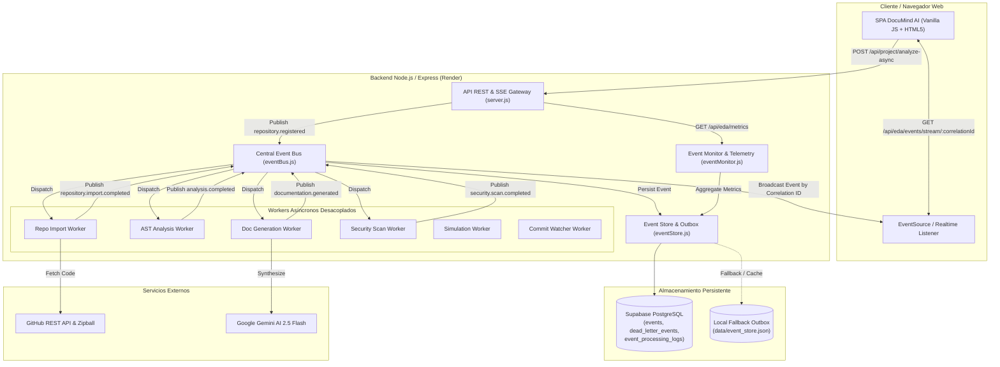
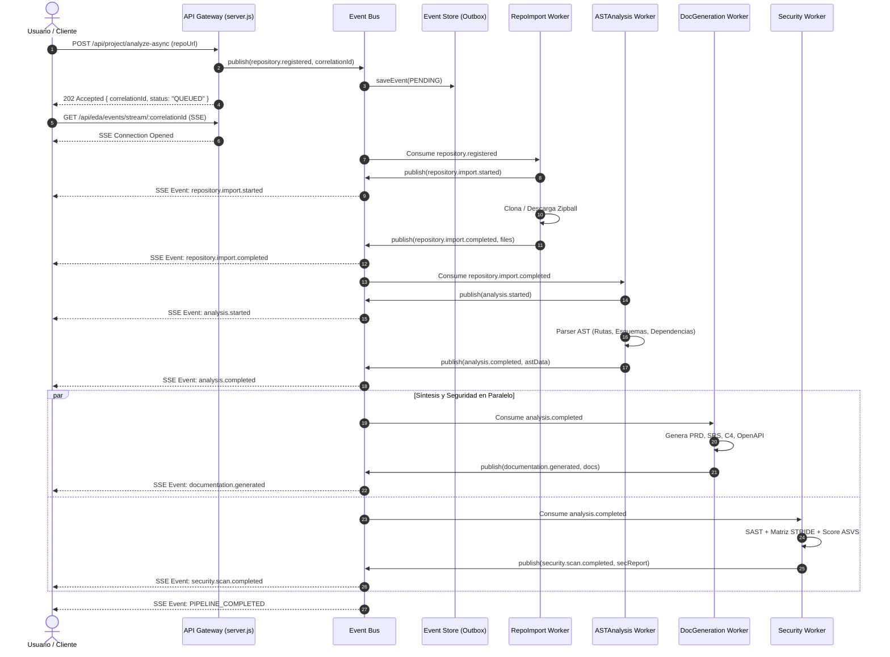

# Documentación de Arquitectura Orientada a Eventos (EDA) — DocuMind AI

> **Universidad Libre — Facultad de Ingeniería**  
> **Curso:** Ingeniería Aplicada (2026-2)  
> **Sistema:** DocuMind AI (Platform Core v2.0)  
> **Patrón Arquitectónico:** Event-Driven Architecture (EDA) con Transactional Outbox, Workers Asíncronos, Dead Letter Queue (DLQ) y Supabase Realtime / SSE.

---

## 1. Resumen Ejecutivo y Motivación

DocuMind AI evolucionó desde una arquitectura monolítica hacia una **Arquitectura Orientada a Eventos (EDA)** para resolver tres cuellos de botella críticos:
1. **Desacoplamiento Operacional:** La clonación, análisis de AST, síntesis documental con IA (Gemini) y escaneo SAST/STRIDE ahora operan de forma independiente y asíncrona, evitando que una falla en un paso bloquee el ciclo completo.
2. **Resiliencia y Confiabilidad:** Implementación de persistencia dual (Transactional Outbox en PostgreSQL Supabase y fallback local inmutable), reintentos automáticos con backoff exponencial y escalamiento a Dead Letter Queue (DLQ) tras agotar reintentos.
3. **Observabilidad en Tiempo Real:** Transmisión de estados mediante Server-Sent Events (SSE) y Supabase Realtime basada en `correlation_id`, permitiendo al usuario monitorear el progreso exacto sin recargar la página.

---

## 2. Diagrama de Contenedores C4 (Mermaid)

---

## 3. Diagrama de Secuencia del Flujo de Análisis Asíncrono

---

## 4. Catálogo Canónico de Eventos del Sistema

Todos los eventos cumplen el contrato inmutable estricto:

| Nombre del Evento | Dominio | Descripción | Productor | Consumidores |
| :--- | :--- | :--- | :--- | :--- |
| `repository.registered` | Repository | Se registra una petición de análisis de repositorio | API Gateway | `RepoImportWorker` |
| `repository.import.started` | Repository | El worker de importación inicia descarga o clonación | `RepoImportWorker` | SSE Stream / UI |
| `repository.import.completed` | Repository | Archivos descargados y validados en memoria | `RepoImportWorker` | `ASTAnalysisWorker` |
| `repository.import.failed` | Repository | Error al obtener repositorio o límite GitHub | `RepoImportWorker` | DLQ / Alerting |
| `repository.commit.detected` | Repository | Se detecta un nuevo commit en el repositorio público | `CommitWatcherWorker` | UI / Re-analizador |
| `analysis.requested` | Analysis | Solicitud explícita de análisis estructural | API / UI | `ASTAnalysisWorker` |
| `analysis.started` | Analysis | Inicio de parseo de sintaxis abstracta | `ASTAnalysisWorker` | SSE Stream / UI |
| `analysis.completed` | Analysis | Extracción de endpoints, modelos y componentes exitosa | `ASTAnalysisWorker` | `DocGenerationWorker`, `SecurityScanWorker` |
| `analysis.failed` | Analysis | Fallo en extracción AST | `ASTAnalysisWorker` | DLQ / Event Store |
| `documentation.generation.requested` | Docs | Solicitud de síntesis documental | API / Bus | `DocGenerationWorker` |
| `documentation.generated` | Docs | PRD, SRS, C4, OpenAPI y diagramas generados | `DocGenerationWorker` | UI / Cache Service |
| `documentation.updated` | Docs | Documentación ajustada tras cambio de código | `DocGenerationWorker` | Cache Service |
| `documentation.generation.failed` | Docs | Fallo en IA o generación determinista | `DocGenerationWorker` | DLQ / Fallback |
| `security.scan.requested` | Security | Petición de auditoría de seguridad SAST | API / Bus | `SecurityScanWorker` |
| `security.scan.completed` | Security | Informe de vulnerabilidades, STRIDE y puntuación listo | `SecurityScanWorker` | UI / Export Service |
| `security.issue.detected` | Security | Se detecta un secreto expuesto o fallo crítico | `SecurityScanWorker` | Alerting / Log |
| `simulation.started` | Simulator | Inicio de cálculo matemático M/M/c de arquitecturas | `SimulationWorker` | UI |
| `simulation.completed` | Simulator | Modelo computacional converge con arquitectura ganadora | `SimulationWorker` | UI / Report Export |
| `simulation.failed` | Simulator | Entrada inválida o saturación no convergente | `SimulationWorker` | UI / Alerting |
| `user.session.started` | Users | Registro de sesión y latido de visitante | Analytics Service | Analytics Monitor |
| `user.project.created` | Users | Creación de proyecto en historial | Project Controller | History Service |

---

## 5. ADR-003: Adopción del Patrón Transactional Outbox con Supabase y Resiliencia en Workers

### Estado
Aceptado e Implementado (Noviembre 2026).

### Contexto
DocuMind AI requería procesamiento asíncrono para operaciones pesadas (descarga de código, AST parsing, síntesis Gemini y SAST). Introducir infraestructura pesada como Apache Kafka o RabbitMQ en una plataforma alojada en Render Free/Standard incrementaba la complejidad de despliegue, el costo de mantenimiento y el riesgo de indisponibilidad.

### Decisión
1. **Bus Centralizado en Node.js:** Implementado en memoria con suscripciones fuertemente tipadas y soporte para Server-Sent Events (SSE).
2. **Transactional Outbox Dual:**
   - Almacenamiento primario en **Supabase PostgreSQL** utilizando las tablas `events`, `dead_letter_events`, `event_processing_logs` y `event_consumers`.
   - Fallback local inmutable (`data/event_store.json`, `data/dead_letter_store.json`) que garantiza continuidad de servicio sin caídas cuando la conexión de base de datos experimenta latencia o falta de migración.
3. **Idempotencia Estricta:** Verificación de `event_id` contra el registro de procesados para descartar eventos duplicados sin reprocesar.
4. **Reintentos con Backoff Exponencial y Jitter:** Reintentos automáticos (`Math.pow(2, attempt) * 1000 + jitter`) ante errores transitorios.
5. **Dead Letter Queue (DLQ):** Al agotar el límite de reintentos (`max_retries = 3`), el evento transita inmutablemente a DLQ para inspección y reprocesamiento manual vía `POST /api/eda/retry/:eventId`.
6. **Recuperación ante Caídas:** Al iniciar el servidor, cualquier evento en estado `PROCESSING` huérfano se reinicia a `PENDING` automáticamente.

### Consecuencias
- **Positivas:** Cero dependencias de infraestructura adicional (Kafka/RabbitMQ), compatibilidad total con el stack existente de Node.js + Supabase, latencia submilisegundo en entrega local, visibilidad en tiempo real mediante SSE y 100% de cobertura en tests automatizados.
- **Mitigaciones:** Para alta concurrencia distribuida multi-instancia en el futuro, las tablas PostgreSQL de Supabase ya cuentan con triggers `updated_at`, índices optimizados y soporte para bloqueos optimistas.

---

## 6. Endpoints de la API EDA

- `POST /api/project/analyze-async`: Inicia el pipeline asíncrono. Devuelve inmediatamente `202 Accepted` con `correlationId`.
- `GET /api/eda/events/stream/:correlationId`: Canal SSE que transmite en vivo los eventos correspondientes a la correlación.
- `GET /api/eda/events/status/:correlationId`: Consulta del estado y traza de eventos de una tarea específica.
- `GET /api/eda/metrics`: Métricas consolidadas (tasa de éxito, eventos completados, latencia promedio, distribución por tipo, cola de mensajes muertos).
- `POST /api/eda/retry/:eventId`: Reactivación de un evento fallido desde la Dead Letter Queue.
- `POST /api/eda/events/publish`: Publicación de eventos desde módulos desacoplados o integraciones externas.

---

## 7. Verificación y Resultados de Pruebas

La arquitectura cuenta con una suite automatizada en [tests/test_eda.js](file:///c:/Users/danis/Documents/IngenieriaAplicada/tests/test_eda.js) y se integra en la suite global en [tests/test_api.js](file:///c:/Users/danis/Documents/IngenieriaAplicada/tests/test_api.js):
- **10/10 pruebas EDA aprobadas** (contratos, sanitización, bus, idempotencia, backoff, DLQ, recuperación de reinicio, SSE, pipeline multinivel y métricas).
- **42/42 pruebas de suite integral aprobadas** (análisis, seguridad, simulador, analítica y EDA).
